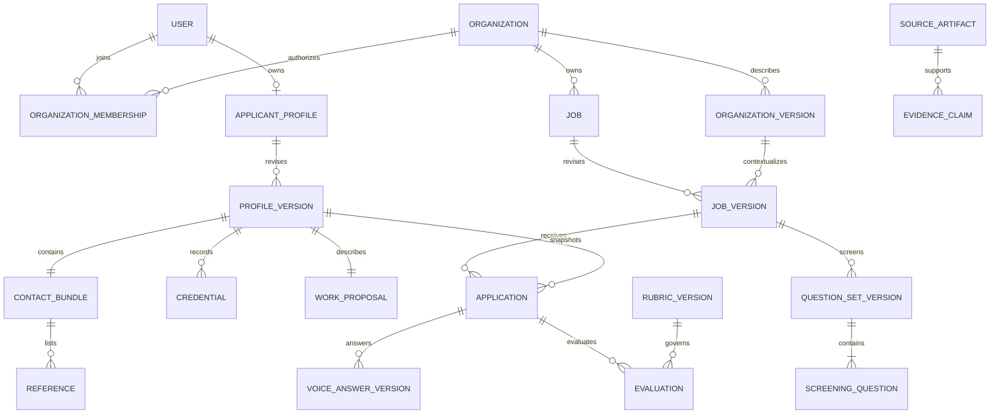

# Proposed Sauce data model

All entities and constraints below are proposals for review. IDs are opaque UUIDs;
timestamps are UTC. PostgreSQL is a proposed starting point, reusing the team's existing
experience, not a requirement imposed on the otherwise-empty Sauce repository.

## Ownership and relationships

A user can be both an applicant and an organization member. Roles belong to memberships,
not a single global `role` field. A demo persona is a distinct principal in a demo workspace;
changing a UI toggle never changes production permissions.

## Source and interpretation layer

| Entity | Key fields and purpose |
| --- | --- |
| `source_artifact` | id, owner principal/scope, kind, content hash, storage key, MIME type, filename, bytes, created_at, retention/deletion status. Kinds: organization_md, jd_md, manager_audio, applicant_material, screening_audio. Raw voice objects are private. |
| `transcript_version` | id, audio artifact id, original ASR text, reviewed text, language, transcription provider/model if applicable, confirmed_by/at. Retain correction history while source is retained. |
| `extraction_run` | source versions/hashes, extractor/prompt version, output hash, status, started/completed_at. Reprocessing is a new run, never an overwrite of the original. |
| `evidence_claim` | structured field/value, subject version, exact source span or audio time range, origin self_reported/extracted/manager_confirmed/verified, verification record if any, review state. Model confidence is optional and uncalibrated unless measured; it is not verification. |

Use explicit typed association tables for artifact ownership and entity evidence, rather than
unconstrained polymorphic IDs where relational constraints matter. Uploaded Markdown is
content, never trusted agent instructions; do not execute embedded commands, fetch embedded
URLs automatically, or allow document instructions to redefine permissions or scoring.
A hash deduplicates bytes within an authorized scope; it does not prove who authored them.

## Hiring-manager data

| Entity | Proposed fields |
| --- | --- |
| `organization` / `organization_membership` | organization id/name; member user id, role, active state. Separate permissions for editing jobs and reviewing applications if needed. |
| `organization_version` | organization id, version, Markdown artifact id, extracted context, manager-confirmed context, confirmed_by/at. Whether this is reusable across jobs remains Sagar's decision. |
| `job` | organization id, id, lifecycle, current published version pointer, creator. |
| `job_version` | job id, version, organization_version id, JD artifact id, manager audio/transcript version id, confirmed structured brief, unresolved conflicts, status, confirmed_by/at. All three intake sources are required to confirm. |
| `question_set_version` | job_version id, version, generator/prompt version, draft/approved status, approved_by/at, content hash. |
| `screening_question` | question-set id, ordinal 1..3, text, purpose, cited requirement/evidence ids, required flag. Unique ordinal per question-set. No hidden fourth question or unbounded generated follow-ups. |

Manager interpretation must surface conflicts between JD and voice; it cannot silently
prioritize the voice over the JD. A confirmed job version is immutable. New job, question
or rubric wording creates a new version and never rewrites active applicants' requirements.

## Applicant data — three sections

| Section | Proposed normalized records |
| --- | --- |
| Credentials | `credential`: education or employment, institution/employer, title or degree, field, partial start/end dates, current flag, description, source/evidence ids, self-report/verification state. Unknown dates remain unknown. A LinkedIn URL does not import or verify experience. |
| Work proposal | `work_proposal`: applicant's original statement plus reviewed structured preferences such as work types, scope, interests, availability, location and compensation where supplied. Required fields and taxonomy are open decisions. |
| Contacts and references | `contact_bundle`: LinkedIn URL, email, phone where supplied; `reference`: name, relationship, organization, contact methods, applicant permission-to-contact state, independent verification status. Required contact methods and reference count remain undefined. |

`applicant_profile` is owned by the applicant globally, not by the first company to see it.
`profile_version` snapshots all three sections. Creating an application explicitly grants
that job's authorized reviewers access to the submitted version; it does not expose the
applicant's whole profile history or other applications. Separate private contact storage
from evaluation inputs. Never merge applicants merely because their names match or because
a shared recruiter/reference has the same phone. Identity linking needs an explicit,
verified process; reference records are not applicant accounts.

## Application and voice answers

`application`: applicant id, target organization/job/job_version, question_set_version,
profile_version, status, draft_revision, submitted_at, withdrawn_at. Proposed first demo
policy: one application per applicant/job, with draft revisions and explicit resubmission
history; Sagar must confirm before this becomes a database uniqueness constraint.

`voice_answer_version`: application id, question id from the pinned question set, take number,
private audio artifact id, transcript_version id, confirmed_by/at. Retakes create new takes;
`application_answer` selects the reviewed take for each question. A final submission snapshot
pins those selected take IDs. Text-only screening submissions are rejected. Transcript
correction edits the voice-derived transcript; it does not fabricate a recording. A client
`input_mode: voice` field alone is not proof of audio capture. Require an owned, completed
backend audio-upload record (or a separately approved trusted capture contract).

All applicant screening responses are voice based, including through MCP: an MCP client
uploads audio first and references its artifact ID. It cannot bypass this by supplying text.
The existing iMessage implementation only provides the current transcription path; adding
persisted audio needs a later client change and does not exist in this architecture package.

## States and version guarantees

- Job version: draft → awaiting_confirmation → confirmed; job: draft → open → closed.
- Question set: generated_draft → approved. Publishing requires an approved set of 1–3 questions.
- Application: draft → ready → submitted → withdrawn. Reopening/resubmission is a versioned action,
  not mutation of a previously submitted snapshot. Ready requires the three profile sections
  and reviewed voice answers to required questions; exact section completeness rules are open.
- Evaluation: not_configured, queued, running, complete, insufficient_evidence, failed, superseded.
  Worker failure and insufficient evidence are distinct; neither means an applicant failed.
- References: not_requested / permission_recorded / contacted / verified. Contacting references
  is outside this architecture phase and must never be triggered merely by profile submission.

A late JD edit or question regeneration does not force an applicant onto a new version.
Manager follow-up conversations are separate messages, not extra screening questions or hidden
scoring evidence. Adding a follow-up screening round needs an explicit product decision;
the initial cap of three cannot be evaded by labeling questions as chat messages.

## Access and storage rules

| Actor | Read/write boundary |
| --- | --- |
| Applicant | Own profile, draft/answers and submissions; visible jobs. No other applicants or manager-private notes. |
| Job reviewer | Assigned organization's/job's submitted application snapshots and permitted contact bundle; cannot edit applicant originals or draft answers. |
| Group participant | Shared job summary and invitation context only. Group membership alone grants no application access. |
| MCP client | Same principal-bound policy as HTTP; no arbitrary actor_id impersonation. |
| Worker | Only queued source/evaluation IDs with the minimum required scope; no global candidate dump. |

For organization-owned tables, carry organization_id through child keys and composite foreign
keys to prevent cross-organization linkage. For candidate-owned artifacts, use explicit
per-application sharing grants and ownership checks; do not model them as organization-owned.
Use short-lived object download URLs issued only after authorization, no public audio bucket.
Row-level security can be defense in depth, but policies need tests and are not implemented here.
Specify audio retention and deletion before storage rollout; deletion removes derived retrieval
indexes as well. Mark historical evaluations unavailable if source evidence is deleted rather
than claiming permanent reproducibility. Metadata/audit retention must be decided explicitly.
