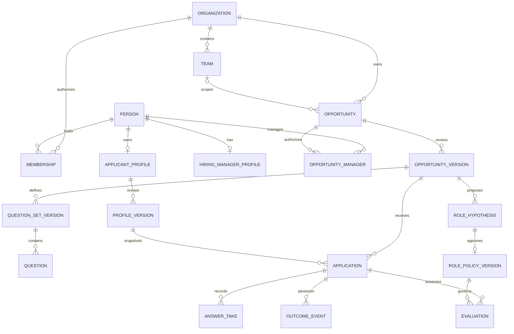

# Sauce architecture — Organization, Person, Opportunity

Status: design handoff for Sagar, Danish and the frontend team. **Organization, Person and Opportunity are the three primary objects.** Applicant and HiringManager are role-specific profiles/relationships of Person, not separate identities. This supersedes the earlier two-object view. Supporting records preserve applications, sources, questions, approvals and history; no backend, migrations or trained models are implemented here.

## The object graph

IDs are opaque; timestamps are UTC. One Person may be both an applicant and a manager. Membership/assignment grants organization/opportunity permissions; a role toggle does not. Employee participation is a membership or interview relationship, not a fourth primary object. An Application connects a particular Person/profile snapshot to one Opportunity/version; scores are never global Person attributes.

## Organization

| Subdata | Proposed contents |
| --- | --- |
| Identity | id, name, optional verified domain, lifecycle. A matching email domain does not grant membership. |
| Context versions | original organization Markdown, extracted/reviewed context, citations, confirmation/version/hash. |
| Teams | team id/name, remit/context version, assigned members. Team context does not silently become company-wide requirements. |
| Memberships | person id, organization id, permissions, active state, grant provenance. |
| Collections | owned opportunities, historical import batches and authorized employee-context interviews. |

## Person

| Subdata | Proposed contents |
| --- | --- |
| Identity | person id, linked auth subject when claimed, identity/contact references, ownership state. Do not merge by name, school, shared reference or phone suffix. |
| Applicant profile | Three sections: credentials (academic/work history with original Markdown/resume), work proposal (Markdown and reviewed preferences), private contacts/references. Submitted versions are immutable. |
| HiringManager profile | Organization membership, opportunity assignments and preferences. Per-role JD, voice vision, criteria and weights belong to Opportunity. |
| Participation | Applications, manager assignments and employee-context interviews, each separately authorized. |

Historical imports may create organization-scoped **unclaimed Person records** and source-backed applicant snapshots. They do not create accounts, applicant consent or public profiles. Linking an import to a self-owned profile requires a reviewed, verified claim and sharing process. Never merge people across organizations automatically. Imported resumes are historical self-reports, not current applicant-confirmed profiles. References are separate contact records, not automatically Person accounts or verified endorsements.

## Opportunity

| Subdata | Proposed contents |
| --- | --- |
| Opening | organization/team, authorized managers/reviewers, role, seniority, current requirements, cycle, lifecycle and immutable versions. |
| Three manager sources | pinned organization-context version, JD Markdown, manager vision recording and reviewed transcript. |
| Requirements | confirmed job-related criteria, source citations, required/preferred distinction, conflicts and unknowns. |
| Questions | manager discovery, employee context, applicant screening and applicant inquiries, with versions, purpose, respondents and visibility. |
| Historical context | reviewed imports, source opportunities/cycles, stage events, comparable cohorts and pattern proposals. |
| Hiring hypothesis | 7–8 ordered lines with supporting evidence/uncertainty and review state. |
| Role policy | approved criteria/anchors, three weights, missingness and prioritization rules, screening set, source versions/cutoff and approval. |
| Current cycle | applications, selected voice answers, evaluations, prioritized-list snapshots and explicit human outcome events. |

`HiringCycle` is a supporting Opportunity record: id, opportunity id, predecessor cycle, opening/closing dates, current policy version and review state. Each application, import comparison, list and event pins a cycle; a later cycle cannot overwrite earlier outcomes. The fixture's `cycle_id` identifies the illustrated cycle snapshot. Decide whether a substantially changed role is a new Opportunity rather than another cycle of the same opening during manager review.

The manager supplies organization MD, JD MD and voice vision; **Organization owns its context, Opportunity owns role-specific JD/vision/policy**. Applicant credentials/proposal/contacts live under Person.ApplicantProfile; screening answers and outcomes belong to each Application. The [question and file contract](QUESTIONS_AND_FILES.md) defines both sides' questions and processing types.

## Preserve historical stages as events

`OutcomeEvent`: id, organization/opportunity/application/cycle IDs, event type, occurred_at (nullable), recorded_at, source artifact/row, original label, mapping version, actor/source system and correction/supersession reference. Preserve **shortlisted, offered, accepted and hired** separately. Additional events may include applied, rejected, offer_declined, withdrawn and started when actually documented.

Do not infer hired from accepted or backfill offered from accepted. “Selected” needs a reviewed source-stage mapping. Missing history is unknown, not rejection. Latest-stage displays are derived views; they do not replace the event ledger. Corrected or late-imported events retain provenance. Stage-specific candidate sets at a declared cutoff may overlap; do not collapse them to `successful: true`.

`Application`: Person/applicant profile, organization/opportunity/version, immutable profile snapshot, source `direct` or `historical_import`, screening/selected-take versions where applicable, import provenance, lifecycle and submission/withdrawal times. Historical imports are not new live voice applications and can legitimately lack today's screening answers.

## Supporting records for the nine-step workflow

| Record | Proposed contents and invariant |
| --- | --- |
| ImportBatch | files/hashes, source organization/opportunities, column/stage mappings, reviewed identity-resolution plan, counts/rejections/conflicts, fingerprint, approval and apply/reversal history. Apply only the exact reviewed plan; stale previews fail. Reversal marks dependent evidence/runs stale without undoing unrelated later decisions. |
| HistoricalCohortVersion | source applications, role/team/seniority comparability, cutoff, information available before each stage, inclusion/exclusion reasons, coverage/missingness and digest. Outcome labels are not same-stage prediction inputs. |
| PatternProposal | explicit job-related characteristic, comparison stage/groups, citations, counts/denominators, missingness, method/version, counterexamples, alternative explanations and review state. Insufficient data produces insufficient evidence. |
| ContextInterview | opportunity, reviewed consenting participant, discovery questions, original/reviewed answers, source-backed work/ability/experience observations and access policy. Recommendations explain why a participant is relevant; no automatic invitations. |
| RoleHypothesis | 7–8 semantic lines with evidence/uncertainty metadata, opportunity/cohort/interview versions, generator version, revision and review status. Prose is not an executable rubric. |
| RolePolicyVersion | confirmed requirements/anchors, three weights, allowed evidence, factual-requirement and unknown policies, screening set, prioritization/tie rules, hypothesis/cohort/context versions, approver/time and hash. Manager approval pins sources; changes create new versions. |
| Evaluation | submission + opportunity/profile/question/answer/policy versions, input digest, model/metric/prompt versions, three cited component assessments, nullable aggregate/coverage and review state. |
| PrioritizedListSnapshot | opportunity/cycle/policy, comparable evaluation IDs, ordering/tie rules, gaps/coverage, unknown/noncomparable section, creator/time and exclusions. No automatic rejection; human decisions remain distinct events. |

Historical advancement is not evidence of employee performance or proof that a characteristic caused advancement. Historical selection, record gaps, changed role requirements and respondent selection can affect observations. Proposed criteria must concern actual work; do not use protected traits, inferred emotions/personality, identifiers, accent, school prestige or demographic proxies for scoring/prioritization. A manager-approved hypothesis still needs supporting evidence. Current-role requirements can contradict history; surface the disagreement rather than letting old hires automatically define the future role.

Build an explicit evaluator input projection: omit private contacts, names, photos, age/date-of-birth and graduation-year proxies; keep only relevant education/qualification content rather than school-brand prestige, and relevant work evidence rather than employer-brand prestige. Retain originals privately for provenance, but do not pass the entire raw resume/contact bundle to a fit model by default. The characteristic/criterion allowlist and projection version must be reviewable. Do not infer protected traits from historical documents or voice to fill missing fields.

The three evaluators remain profile matching, transcript content and explicitly approved observable delivery (`composite_profile`, `voice_transcript`, `voice_behaviors`). Historical patterns propose policy; they are not a fourth score. All numeric anchors/weights and exact ordering rules remain Sagar's decisions. Unknown positive-weight evidence produces a null aggregate under the proposed missingness rule. Do not silently drop unknown applicants from review or mix results from different policies as if comparable.

## Raw files, voice and training lineage

Private durable object storage preserves Markdown, resumes, original recordings, original ASR/provider JSON, separately reviewed transcripts and derived files. Database records hold authorized ownership, content hashes, MIME/container/codec, size/duration, parser/provider versions, links, task states and retention/training eligibility.

`EvidenceClaim` points to exact text spans/pages/import rows/audio intervals and distinguishes self-report, extraction, confirmation and verification. `AnswerTake` binds respondent, application/interview, exact question version, audio hash, original/reviewed transcript and selected take. For group interviews, reviewed speaker mapping establishes attribution; diarization labels alone do not establish identity. Corrections never overwrite original audio/ASR; missing alignment after a text edit stays explicit. Retakes create new lineage.

New direct screening submissions select owned completed recordings and reviewed transcripts for 1–3 approved questions; text-only or `input_mode: voice` is insufficient. Keep manager/employee context and applicant inquiries out of additional scored screening. Workers are authenticated, idempotent and source-versioned; late results cannot replace a newer selected take. Processing failure, insufficient evidence, unconfigured scoring and a human hiring-stage event are different states.

Separate dataset/training/model versions from role-policy versions. Eligible data and reviewed labels may later support transcript-content and observable-audio tasks; saving files or updating a hypothesis does not train a model. Historical stage outcomes alone are not ground-truth applicant quality, emotion or job performance. Dataset splits respect person/opportunity/cycle and timing boundaries; retain a held-out evaluation set. New outcomes draft new proposals, never automatically change approved policy, retrain or deploy a checkpoint.

## Access and naming

Applicants own their live profiles/drafts/answers. Organization reviewers receive access only to assigned submitted or lawfully imported snapshots; employee context, contacts and historical data have separate grants. An iMessage group sees a shared opportunity card, not private application or interview audio. HTTP/MCP use identical principal-bound authorization. No arbitrary client-supplied actor override. No automatic reference contact or outreach arises from an upload.

Retention/deletion must propagate to derived files/indexes and mark dependent evaluations/datasets stale or unavailable. Track affected model lineage; do not promise source deletion untrains an existing checkpoint. Provider data-processing settings and training permissions need agreement before real collection.

Canonical new names: `person_id`, `opportunity_id`, `opportunity_version_id`, `role_policy_version_id`. Earlier illustrative contracts use `applicant_id`, `job_id`, `job_version_id`, `rubric_version_id`. These are legacy names for the same concepts, not separate job/person systems. Agree a versioned adapter; reject mixed conflicting ID fields. Existing v1 JSON schemas are not a v2 domain specification.

Read [the nine-step workflow and integration plan](WORKFLOW_AND_INTEGRATIONS.md), [question/file types](QUESTIONS_AND_FILES.md), and [the normalized storage appendix](DATA_MODEL.md). Framework, codec/size limits, retention, exact wire routes and approved scoring rules still need team decisions.
