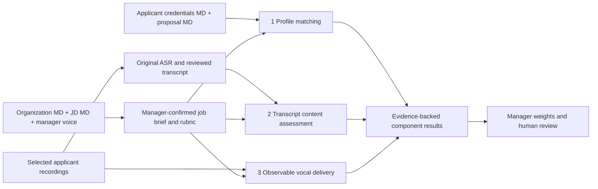

# Sauce object architecture and Replit voice handoff

For Sagar and Danish. Status: proposed integration design, not implemented endpoints or trained models. This simplifies the product view of the existing architecture without discarding versioning, ownership, or evidence. Sagar owns final fields, rubric anchors, and scoring weights. Danish's development platform is Replit; his framework and voice provider are not yet specified.

Start with the current [Organization, Person, Opportunity architecture](../backend-architecture/OBJECT_ARCHITECTURE.md), [nine-step workflow](../backend-architecture/WORKFLOW_AND_INTEGRATIONS.md), and [four question purposes/file types/ElevenLabs adapter](../backend-architecture/QUESTIONS_AND_FILES.md). These supersede the earlier two-object view. ElevenLabs is an available integration candidate; provider configuration/account access are not verified. This document remains the voice adapter and training-lineage handoff.

## The pitch

Sauce connects two people with three kinds of evidence. A hiring manager describes the organization, the work, and the person they need. An applicant shares their experience, the work they want, and answers up to three questions by voice. Sauce compares the written profiles, assesses what the applicant said, and can measure explicitly defined aspects of their vocal delivery. Each result points to the original evidence. The manager decides how much each supported component matters and reviews the result.

The product has three main objects: **Organization**, **Person**, and **Opportunity**. Applicant and HiringManager are Person role profiles. An Application connects a Person's submitted applicant-profile version to an Opportunity/version. Files, transcripts, stage events, hypothesis/policy versions and processing runs are supporting records.

The proposed third path is **observable vocal delivery**, not an emotion or sentiment classifier. Do not infer applicants' inner emotions, personality, honesty, or suitability from vocal affect. Measures such as pace and pause timing describe a recording; any interpretation for hiring needs explicit job-related criteria and human review. If those criteria are absent, return observations with no score. Neither more pauses nor faster speech is inherently better.

## Three primary objects and role entry points

```text
Organization
  context Markdown versions, teams, memberships, opportunities
Person
  identity and authorized organization relationships
  Applicant profile: credentials, proposal, private contacts/references
  HiringManager profile: memberships and opportunity assignments
Opportunity
  company/team/role/seniority/current requirements
  pinned organization context + JD Markdown + manager voice vision
  historical pool/stage events and reviewed pattern proposals
  manager/employee discovery, applicant screening and applicant inquiries
  7–8-line hypothesis and immutable manager-approved role policy
  Application snapshots: Person + profile + opportunity/policy versions
    selected voice answers[1..3], evaluations and human stage events
```

These are API/domain views; their child records may be normalized in storage. One Person can hold both roles; a frontend role toggle does not grant permissions. Historical imported people stay organization-scoped and unclaimed until a verified linking/sharing process is agreed.

| Role entry point | Three intake sections | Where the records belong |
| --- | --- | --- |
| Person.HiringManager | Organization Markdown, JD Markdown, manager voice vision | Organization owns context versions; Opportunity owns JD/vision, requirements, question sets and approved role policy. |
| Person.Applicant | Credentials, work proposal, contacts and references | Person owns profile versions and private contacts; each Application owns selected screening answers and outcome history for its Opportunity. |

Sagar's latest request calls for applicant Markdown to be cross-referenced with manager Markdown. Proposed first intake: `credentials.md` for academic/work history and `proposal.md` for desired work; keep contacts and reference contacts structured and outside evaluator inputs. The exact applicant upload/form UX is still to be agreed. Markdown originals remain authoritative source material; extracted fields are derived and reviewed. A listed reference is not a verified endorsement.

An application remains necessary: the same Person can apply to different Opportunities, with different questions, answers, policies and results. Never store one global Person fit score. A result belongs to **an applicant submission × an opportunity version × a role-policy version**. Earlier voice v1 fixtures use `job_version_id`; agree a versioned adapter to canonical `opportunity_version_id` before integration.

## Three independent scoring paths



| Component key | Question it answers | Evidence and output |
| --- | --- | --- |
| `composite_profile` | Does this person's demonstrated experience and proposed work align with the role? | Cross-reference applicant Markdown against confirmed criteria derived from organization/JD/manager vision. Return criterion-level met/unmet/unknown, source spans on both sides, and a nullable anchored score. Add reference evidence only if separately permitted and verified. |
| `voice_transcript` | What evidence is in their answers? | Use applicant-reviewed transcripts, the exact questions, and approved content anchors. Return cited answer spans and a nullable score. Keep acoustic delivery judgments out of this path. |
| `voice_behaviors` | What directly observable delivery evidence exists for an approved communication criterion? | Use the original selected audio with quality checks. Return timestamped measures with units, method/version and uncertainty. Score only against approved job-related anchors with human review; otherwise score is null. No emotion or hidden-trait labels. |

Manager Markdown and voice define the target. They are **not** the three weighted scoring components. The manager recording is not an applicant delivery sample.

These are three evaluators, not necessarily three newly trained neural networks. Profile matching can start with reviewed extraction and a rubric evaluator. Two separately versioned learned components can later handle transcript content and audio processing. Speech-to-text is a separate preprocessing task, even if it uses an existing provider's model.

All configured component scores need a common anchored scale before they can be combined:

```text
overall = w_profile * s_profile
        + w_transcript * s_transcript
        + w_behaviors * s_behaviors
```

Weights are manager-set, normalized, and sum to one. No numerical defaults or anchors are approved. A positive-weight component with missing/unusable evidence makes the aggregate null; do not substitute zero or silently redistribute its weight. A zero-weight component may be unassessed. An unavailable score is not a failed applicant. Report the components and evidence, not just a total, and do not make automatic hiring decisions.

## Store unstructured originals and structured references

The raw evidence remains unstructured. The index describing it must be structured so we can find, authorize, version, and reproduce processing.

| Storage | Contents |
| --- | --- |
| Private durable object storage | Original `.md` files; original audio in its uploaded format; original ASR text/JSON; reviewed transcript text; derived alignment/measurement JSON. Model checkpoints and dataset manifests can use separate restricted namespaces later. |
| Database | Owners and sharing grants; object keys, SHA-256 hashes, MIME types and byte sizes; versions and source links; application snapshots; rubric anchors/weights; worker states; model/dataset/run versions; component assessments. Contact data has a separate access boundary. |

Each voice answer points to a `VoiceArtifact` and a `TranscriptVersion`. Keep original ASR separate from applicant corrections. A transcript edit never rewrites the audio or its timestamps: preserve original aligned segments, and record the correction mapping or mark reviewed-text alignment unavailable. Replacing a take creates a new recording and transcript lineage.

Proposed minimal supporting records:

```text
Artifact
  id, ownerId, kind, storageKey, sha256, mimeType, byteSize
  uploadState, retentionState, createdAt

VoiceAnswer
  id, applicationId, questionId, takeNumber, audioArtifactId
  originalTranscriptVersionId, reviewedTranscriptVersionId
  selectedForSubmission, confirmedBy, confirmedAt

ProcessingRun / Evaluation
  id, task, inputVersionIds, inputDigest, status
  provider, modelVersion, promptOrMetricVersion, outputArtifactIds
  componentResults, rubricVersionId, errorCode, timestamps
```

Application submission pins selected takes, profile, job, questions, and reviewed transcripts. Pending processing remains visible as pending; retries reuse an idempotency key. Private audio is fetched only after server authorization through a storage adapter. Keep download URLs short-lived and out of logs. An unguessable storage key is not an access policy.

For Replit, App Storage is one available object-storage option; an existing private external bucket is also compatible. Use one authoritative artifact registry and an adapter rather than independent Sauce and Replit copies with conflicting IDs. Durable file storage should not depend on the Replit application's local working directory. [Replit App Storage](https://replit.com/blog/app-storage) supports uploads with database file metadata. For S3 adapters, use its documented [presigned URL mechanism](https://docs.aws.amazon.com/AmazonS3/latest/userguide/using-presigned-url.html).

## What training actually requires

Saving recordings prepares a corpus. Running a model on a recording is inference. Training changes model parameters using a defined dataset and learning objective. Adding organization/JD context to a prompt is not model training.

| Separate track | Training examples and targets | Versioned output |
| --- | --- | --- |
| Transcript content model | Reviewed answer text + question + job rubric; human-labeled criterion ratings, evidence spans, and insufficient-evidence examples. Exclude audio and contact identifiers from this input. | Transcript model/prompt version, evaluation report, approved release state. |
| Audio processing model | Authorized recordings; human-checked speech boundaries, pause intervals and recording-quality labels for the selected observable tasks. Pace calculations can be deterministic after alignment; a learned model is not required for every measure. | Audio model/metric version, task-specific error report, approved release state. No sentiment/emotion hiring target. |

Use a separate `training_permission` record with scope, policy version, grant/revocation timestamps. Permission to submit an application is not blanket permission to train on it or its references. Start with synthetic or explicitly consented fixtures.

Each dataset version records exact artifact/transcript hashes, inclusion eligibility, label schema/version, reviewer provenance, exclusions, and fixed train/validation/test split assignments. Keep all takes/transcripts from a person in one split; also evaluate held-out jobs to test generalization. Split before fitting preprocessing; held-out examples must not influence fitting or model selection. This follows the leakage principles in [scikit-learn's guidance](https://scikit-learn.org/stable/common_pitfalls.html#data-leakage); person/job grouping is our proposed application of them.

Each training run records dataset version, task, base model/version, code/config version, evaluation report and checkpoint. Each deployed `ModelVersion` records its approved task, provenance and status. An inference run pins that version. Do not deploy a freshly trained checkpoint automatically. Sagar must define acceptance criteria and review failures before a model produces numeric hiring assessments. A hiring decision is not automatically a ground-truth label for either track.

Retention and deletion need a policy before real collection. Delete raw and derived records/indexes consistently and exclude revoked data from future dataset builds. Do not promise that deleting a recording removes its influence from an already-trained checkpoint; track affected dataset/model lineage for an explicit remediation decision.

## Danish's Replit integration boundary

**Proposed division of work:** Sauce owns identities, permissions, files/metadata, profiles/jobs/applications, reviewed transcripts, rubrics, evaluation history, aggregation, and HTTP/MCP access. Danish owns the voice-processing adapter: reading authorized recordings, ASR, alignment, audio quality and observable measurements. His worker returns evidence, never a final hiring decision. If he also implements transcript assessment, expose it as a separate task that runs only after transcript review with a pinned rubric.

Use an authenticated server-to-server JSON interface; framework and provider remain Danish's choice. Store service/provider credentials in server-side secrets, never in a browser bundle or checked-in examples. A job request should be acknowledged quickly and processed asynchronously; use persistent queue/run state rather than relying on an in-memory task surviving a restart.

1. Sauce verifies an uploaded audio artifact and creates a durable processing request.
2. Danish's worker receives `voice.process_requested.v1`, with opaque IDs and source hash. It resolves the recording through an authorized artifact API/storage adapter; it does not accept arbitrary download URLs from applicants.
3. The worker returns `voice.process_completed.v1`, containing the ASR artifact reference, timestamped segments, observations, quality state and model/metric versions. Store any output artifacts through the same registry first.
4. Sauce authenticates the response and checks request, artifact/hash, job/application, owner and schema version. Duplicate completion is idempotent; a mismatched payload is rejected.
5. The applicant reviews the transcript and selects a take. Submission pins those versions. Only then can a separate transcript-content evaluator assess the submitted answer against approved anchors.
6. The backend returns an unscored evidence summary first. Numeric assessment is a later configured step.

See [request fixture](../backend-architecture/examples/voice-process-request.json) and [result fixture](../backend-architecture/examples/voice-process-result.json). They illustrate the wire shape; their IDs are synthetic and their measurements are invented. Routes, shared authentication mechanism, upload codecs/limits and provider bindings are not deployed or agreed.

`completed` means processing produced the requested artifacts, not that the recording is suitable for every assessment. Track transcription and audio-measurement status independently. For example, transcription may succeed while noise makes pause measures unavailable. Error events use the same request ID, attempt number, stable error code, retryable flag and task-level state. An expired download authorization may be refreshed after ownership checks; changed source hashes need a new request. A delayed result for an old take remains attached to that take and must not replace the selected submission.

For manager vision requests, use the same ingestion/transcription service with `source_role: manager_vision`, a job-version context and no applicant/question IDs. Do not run applicant-delivery assessment on that recording.

## First integration Danish can build

Deliver one synthetic job and applicant flow in Replit: private recording ingestion, persisted ASR, transcript review linkage, selected-take submission, and a fetchable evidence summary. Preserve the max-three-question rule. Run the same service from a web demo first; iMessage and MCP become adapters to it rather than separate databases.

Acceptance checks: recording bytes survive an app restart; a foreign artifact is rejected; duplicate requests/results do not duplicate records; retakes and corrections preserve source lineage; unusable audio yields an unavailable component; a fourth question is rejected; text alone cannot masquerade as a recorded answer; contact-only edits do not change evaluation; an unconfigured rubric returns null scores. Include a clean request/result fixture and a README with how to run the Replit app, its authenticated service URL, and required secret **names**, without their values.

### Copy into Danish's Replit Agent

> Build the Sauce voice evidence service using the current Organization, Person, Opportunity architecture and nine-step workflow. Applicant and HiringManager are Person profiles/roles. Opportunity owns discovery/context questions, max-three voice screening questions, applicant inquiries, an evidence-backed 7–8-line hypothesis and an approved versioned role policy. Preserve historical shortlisted/offered/accepted/hired events separately. Preserve original Markdown/resumes, audio, ASR and reviewed transcripts in private durable storage with database metadata. Implement a synthetic upload → transcription → review → submission slice first, with an ElevenLabs adapter if selected and configured. Keep `composite_profile`, `voice_transcript`, `voice_behaviors`; return null scores until approved anchors exist. Audio produces defined observable delivery/quality evidence, with no emotion or personality inference for hiring. Make processing authenticated, asynchronous, idempotent and source-versioned; keep transcript assessment separate from ASR/audio extraction. Historical outcomes draft proposals, never automatically retrain or change policy. Share provider/framework choices and a working request/result pair before binding clients. Do not claim unimplemented model training, MCP or iMessage functionality.

## Decisions to make together

Sagar defines applicant Markdown structure, question/content anchors, permitted delivery criteria or a zero audio weight, training eligibility/retention, and whether results describe fit or rank applicants. Danish chooses/proposes the Replit framework, provider, codecs, alignment representation, deployment/worker mechanism and artifact adapter. Agree on those wire details before binding real clients. No new provider or numerical default is selected by this handoff.

Chewbacca remains a source of provenance, reviewed extraction and version-history patterns: see [pinned references](../backend-architecture/CHEWBACCA_REFERENCES.md). Its relationship scoring and desktop voice runtime are not Sauce's trained evaluators. No code port is implied here.

Related: [full data model](../backend-architecture/DATA_MODEL.md), [scoring semantics](../backend-architecture/SCORING_MODEL.md), [backend voice handoff](BACKEND_VOICE_HANDOFF.md), [shared service contract](INTEGRATION_CONTRACT.md).
